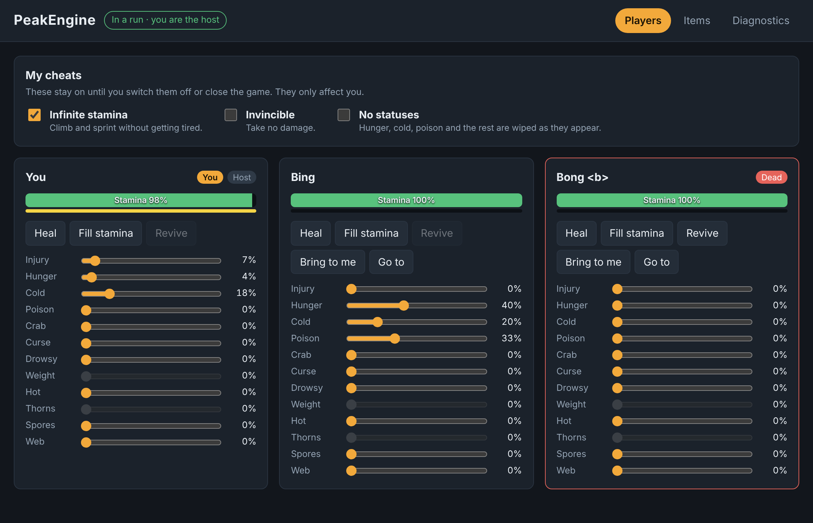
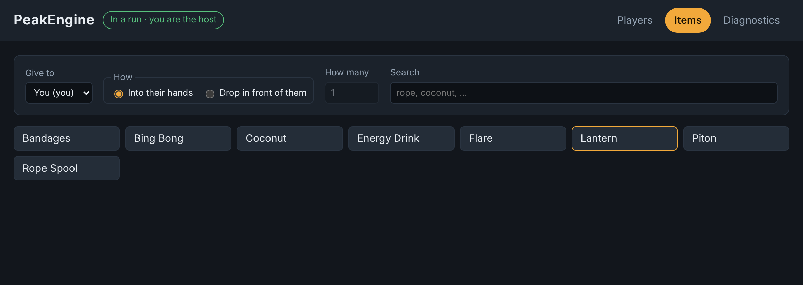
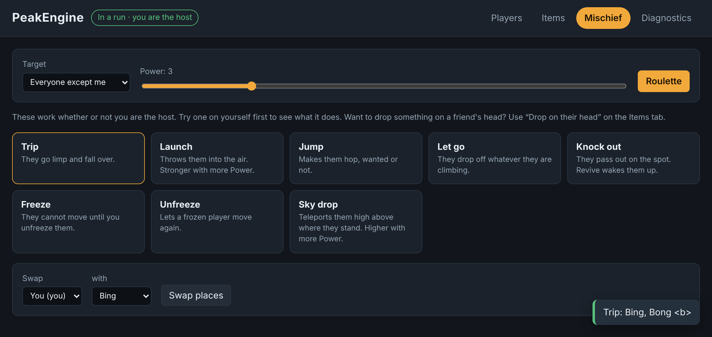

# PeakEngine

A cheat panel for [PEAK](https://store.steampowered.com/app/3527290/PEAK/) that you control from your web browser.
Built for Arch Linux (Steam + Proton), and written so you can read it, learn from it and extend it.



*The Players tab, shown here with the pretend lobby from `./scripts/demo.sh`.*

## What it does

| | You | Your friends |
|---|---|---|
| Set any status (hunger, cold, poison, injury…) to an exact amount | ✅ | ✅ only while **you host** the lobby |
| Heal (clear every status) | ✅ | ✅ only while **you host** the lobby |
| Refill stamina | ✅ | ✅ (fills their bonus stamina bar) |
| Revive | ✅ | ✅ |
| Teleport (bring a friend to you, or go to them) | ✅ | ✅ |
| Spawn any item into someone's hands, or drop a pile in front of them | ✅ | ✅ |
| Always-on: infinite stamina, invincible, no statuses | ✅ | — |
| **Mischief:** trip, launch, forced jump, let go of the wall, knock out, freeze, sky drop, swap places, drop items on their head, prank roulette | ✅ | ✅ host or not |

The "only while you host" rows are a rule of the game itself: it ignores status changes for other
players unless they come from the lobby host. The panel tells you when that applies.





## Honest status: read this first

**This has not been run inside the real game yet.** It was written on a machine without PEAK.
What has been checked:

- The plugin compiles, and its code matches the real BepInEx 5.4.23.3.
- All of it runs against a *pretend* PEAK that copies the real game's class and method names
  (33 automated tests, plus the panel clicked through in a real browser).
- The game's names (like `Character.localCharacter` or `RPC_ApplyStatusesFromFloatArray`) were
  taken from open-source PEAK mods updated in late 2026.

What that cannot prove is that every name still matches *your* version of the game. So the first
time you start PEAK with this installed, open the panel's **Diagnostics** tab. It checks all 49
things PeakEngine looks for and shows exactly which ones are missing, if any.
[docs/05-troubleshooting.md](docs/05-troubleshooting.md) explains what to do then.

## Install (Arch Linux)

You need PEAK installed through Steam first. Then:

```bash
sudo pacman -S --needed curl unzip
git clone https://github.com/Kobalosz/PeakEngine.git
cd PeakEngine
./scripts/install.sh
```

The script finds PEAK, installs the BepInEx mod loader if needed, and copies PeakEngine in.
It ends by telling you the one thing you must do by hand, once, in Steam:

> Right-click PEAK → Properties → General → **Launch Options**, and paste
> `WINEDLLOVERRIDES="winhttp=n,b" %command%`

Start PEAK, then open **http://127.0.0.1:8777** in your browser.

Full walkthrough, manual install and uninstall: [docs/02-install-arch-linux.md](docs/02-install-arch-linux.md).

## Try it without the game

You can click around the panel right now against a pretend lobby (you and two friends):

```bash
sudo pacman -S --needed dotnet-sdk
./scripts/demo.sh
```

Then open http://127.0.0.1:8777. This is also how you work on the panel's JavaScript: edit a
file in `panel/`, refresh the browser.

## How it is built

PEAK is made with the Unity engine, and Unity games can only be modded from the inside with C#.
So there are two halves:

```
 Browser                              PEAK (running through Proton)
┌──────────────────────┐  fetch()   ┌───────────────────────────────────────┐
│ panel/  (JavaScript) │ ─────────► │ plugin/  (C#, loaded by BepInEx)      │
│ sliders, buttons     │ ◄───────── │ tiny web server → calls into the game │
└──────────────────────┘   JSON     └───────────────────────────────────────┘
```

- **`panel/`** is plain HTML, CSS and JavaScript with no build step. This is where most of your
  tinkering will happen.
- **`plugin/`** is a small C# bridge. It is kept deliberately thin and heavily commented, with
  JavaScript comparisons where they help.

| Folder | What is in it |
|---|---|
| `panel/` | The control panel (JavaScript). Start with `js/api.js`. |
| `plugin/src/Routes.cs` | The list of everything the panel can ask for. Start here on the C# side. |
| `plugin/src/Game/` | The code that touches the game: players, statuses, items, toggles, pranks. |
| `plugin/src/Core/` | Plumbing: web server, JSON, running things on the game's main thread. |
| `plugin/tests/` | A pretend PEAK and automated tests. |
| `dist/PeakEngine/` | The ready-to-install build. `install.sh` copies this into the game. |
| `scripts/` | `install.sh`, `build.sh`, `demo.sh`, `test.sh` |
| `docs/` | The guides below. |

## Learn how it works

The docs are written for someone who knows some JavaScript and no C#. In order:

1. [How it works](docs/01-how-it-works.md): follow one slider drag from the browser into the game.
2. [Install on Arch Linux](docs/02-install-arch-linux.md)
3. [API reference](docs/03-api-reference.md): every URL the panel calls.
4. [Add your own cheat](docs/04-add-your-own-cheat.md): a guided exercise that adds a "Wake up" button, end to end.
5. [Troubleshooting](docs/05-troubleshooting.md), including what to do after a game update.
6. [Learning resources](docs/06-learning-resources.md): where to read more about each technology used here.

## Mischief

The Mischief tab is for pranking friends. Pick a target (one player, everyone except you, or
everyone), set the Power slider, and press a prank. **Roulette** plays a random prank on a
random friend. To drop a coconut on someone, use "Drop on their head" on the Items tab.

Two things to know before your first prank:

- **The numbers are guesses.** How hard "Launch" throws and how long "Trip" lasts depend on the
  game's physics, which could not be measured without the game. Try each prank on yourself
  first. The numbers to tune are in `plugin/src/Game/Pranks.cs`.
- **Some pranks can end a run.** A sky drop, or letting go on a tall wall, can kill a friend.
  Revive is one click away on the Players tab.

Adding your own prank is one entry in `plugin/src/Game/Pranks.cs`; the button appears by itself.

## Play nice

PEAK is played in private lobbies with people you invite, so keep it that way: use this with
friends who are in on the joke. PeakEngine is unofficial, the game's developers do
not support mods, and a game update can break it at any time. Some hosts run anti-cheat mods
that kick modded players, so expect that if you join someone else's modded lobby.

## Credits

The game's internal names were learned by reading these open-source PEAK mods and notes
(no code was copied): [peak-host-tools](https://github.com/jleybourne/peak-host-tools),
[PEAK-MX](https://github.com/maxkir041/PEAK-MX), [PeakResume](https://github.com/onizmx/PeakResume),
[PeakTrollMod](https://github.com/rdlawe15-cpu/PeakTrollMod) and [PEAKLib](https://github.com/PEAKModding/PEAKLib).
Mods are loaded by [BepInEx](https://github.com/BepInEx/BepInEx).
