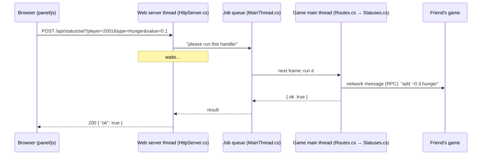

# 1. How it works

This page follows a single action, **dragging your friend's Hunger slider to 10%**, from the
browser all the way into the game. Once you understand that one trip, you understand the whole
project, because every other button takes the same route.

## The two halves

PEAK is built with the **Unity** game engine, and its game logic is written in **C#**. The only
practical way to change a running Unity game is to load your own C# code *into* it. A program
called **BepInEx** does that loading: it starts with the game and loads every "plugin" DLL it
finds in `BepInEx/plugins/`.

A browser cannot reach into a game, and a game is an awkward place to build a nice UI. So
PeakEngine splits the work:

| Half | Language | Job |
|---|---|---|
| `panel/` | JavaScript | The UI. Runs in your browser. Knows nothing about Unity. |
| `plugin/` | C# | Runs inside PEAK. Offers a small web API and translates each call into game code. |

They talk over HTTP on your own machine (`127.0.0.1`), the same way a website's frontend talks
to its backend. If you have built anything with `fetch()` and an Express server, you already
know the shape of this.

## The trip of one slider drag



### Step 1: the browser sends a request

`panel/js/players.js` creates the slider. When you let go of it, this runs (slightly shortened):

```js
slider.onchange = () => {
  run(() => api.setStatus(playerId, type, slider.value / 100));
};
```

`api.setStatus` lives in `panel/js/api.js` and is one line:

```js
export const setStatus = (player, type, value) => post('/api/status/set', { player, type, value });
```

`post()` turns that into `POST /api/status/set?player=2001&type=Hunger&value=0.1` using
[`fetch()`](https://developer.mozilla.org/en-US/docs/Web/API/Fetch_API/Using_Fetch).
**`api.js` is the only file in the panel that talks to the game.** Everything else just calls its functions.

### Step 2: the plugin's web server receives it

`plugin/src/Core/HttpServer.cs` is a very small web server: the C# cousin of Node's
`http.createServer()`. It reads the request text, splits it into method, path and query
parameters, and hands it to the router.

### Step 3: the router checks it and finds the handler

`plugin/src/Core/Router.cs` does what Express does. First it applies three safety checks (see
[Security](#security) below), then it looks the path up in its table of routes. Those routes are
registered in **`plugin/src/Routes.cs`**, which is the C# file you will open most often:

```csharp
// POST /api/status/set?player=1001&type=Hunger&value=0.5
router.Post("/api/status/set", request =>
{
    object player = Players.Find(request.Int("player"));
    Statuses.Set(player, request.Text("type"), request.Float("value"));
    return Done();
});
```

Compare that with Express and you will see it is the same idea in a different accent:

```js
app.post('/api/status/set', (req, res) => {
  const player = Players.find(Number(req.query.player));
  Statuses.set(player, req.query.type, Number(req.query.value));
  res.json({ ok: true });
});
```

### Step 4: hop onto the game's main thread

Here is the one concept that has no everyday JavaScript equivalent.

A **thread** is a separate line of execution; a program can have several running at once. Our
web server runs on background threads so it never slows the game down. But Unity only allows
game objects to be touched from its single **main thread**. Touching them from another thread
can crash the game.

So the router does not run the handler itself. It puts the handler in a queue and waits.
`plugin/src/Core/MainThread.cs` holds that queue. Once per frame, Unity calls our `Update()`
method *on the main thread* (see the `Runner` class in `Plugin.cs`), which runs whatever is queued
and hands the result back to the waiting web thread.

If you know the JavaScript event loop, this will feel familiar: JavaScript also has one thread
that runs your code, and everything else (timers, network replies) has to queue up for it.

### Step 5: the game code runs

Now we are on the main thread inside `Statuses.Set` (`plugin/src/Game/Statuses.cs`). It decides
between two cases:

- **It is your own character.** Call the game's own `SetStatus` method. Done.
- **It is a friend.** Your game does not own their statuses; *their* game does. So we send
  their game a network message asking it to change them.

Those network messages are called **RPCs** (remote procedure calls): "run the method named X on
your copy of this object". The game's multiplayer library, Photon, delivers them. This is the
key to affecting friends: you can only ask their game to run methods **the game already has**,
and some of those methods check who is asking. The one for statuses
(`RPC_ApplyStatusesFromFloatArray`) only obeys the lobby host, which is why the panel says
"only the host can change friends' statuses".

### Step 6: the answer travels back

`Statuses.Set` returns, the handler returns `{ ok: true }`, `Json.cs` turns that into text, and
the browser's `fetch()` resolves. If anything failed, the plugin answers with an error status
and `{ "error": "…" }`, and `run()` in `panel/js/ui.js` shows that message as a red toast.

## How does the panel know what to show?

It asks. Once a second `panel/js/app.js` calls `GET /api/state`, which returns everything:
players, their statuses, stamina, your toggles. That is called **polling**. The panel then
updates the cards with the new numbers.

Polling is the simplest way to stay in sync, and once a second is plenty here. (A fancier
approach would be WebSockets, where the game pushes updates. That is a good later exercise.)

## Why does the C# look things up by name?

Mods are normally compiled *against the game's own DLL*, so you can write
`character.data.currentStamina` and the compiler checks it. PeakEngine instead looks everything
up by name while the game runs, a technique called **reflection**:

```csharp
Reflect.Get(character, "data.currentStamina")   // C#, by name
character["data"]["currentStamina"]             // the same idea in JavaScript
```

This costs a little readability and buys three things:

1. The plugin can be built on any computer, without the game. That is why this repo can ship a
   ready-made DLL in `dist/`.
2. When a game update renames something, only the feature that used it breaks, with a message
   that names the missing thing. A normally compiled mod would refuse to load at all.
3. The **Diagnostics** tab can list exactly which names exist in your version of the game.

All of that lives in `plugin/src/Core/Reflect.cs`. The game-facing files in `plugin/src/Game/`
use it through three small verbs: `Reflect.Get`, `Reflect.Set` and `Reflect.Call`.

## Toggles are different from buttons

A button is a one-off. A toggle like "infinite stamina" must *stay* true while the game keeps
trying to change things back. So `plugin/src/Game/Toggles.cs` has a `Tick()` method that runs
every frame and re-applies whatever is switched on.

## Security

A web server on your computer can be poked by any website you visit, because your browser will
happily send requests to `127.0.0.1`. `Router.cs` blocks that in three ways, each marked with a
`SECURITY` comment in the code:

1. **Host check.** The request must be addressed to `127.0.0.1:8777` or `localhost:8777`. This
   defeats "DNS rebinding", where a hostile site points its own domain name at your machine.
2. **Custom header.** Anything that changes the game needs an `X-PeakEngine: 1` header. Browsers
   do not let other websites add custom headers to cross-site requests unless the server opts
   in (that mechanism is called CORS), and this server never does.
3. **No escaping the panel folder.** A path like `/../../something` is refused.

The server also only listens on `127.0.0.1`, so other devices on your network cannot reach it.

And one on the JavaScript side: player names come from other people, so the panel only ever
inserts them as text (`textContent`), never as HTML. See the comment on `el()` in `panel/js/ui.js`.

## File map

```
panel/
  index.html          the page skeleton: three tabs
  style.css           how it looks
  js/api.js           every call to the game (start here)
  js/app.js           tabs + the once-a-second polling loop
  js/players.js       player cards, status sliders, toggles
  js/items.js         item search and spawning
  js/diagnostics.js   the compatibility table
  js/ui.js            helpers: el(), toast(), run()

plugin/src/
  Plugin.cs           entry point: starts the server, hooks into the frame loop
  Routes.cs           URL → game code (start here)
  Game/GameTypes.cs   the names of the game classes we use
  Game/Players.cs     find players; stamina, revive, teleport
  Game/Statuses.cs    read and change status bars
  Game/Items.cs       list and spawn items
  Game/Toggles.cs     always-on cheats
  Game/Net.cs         multiplayer helpers (RPCs, spawning)
  Game/Diagnostics.cs the self-check
  Core/…              web server, router, JSON, main-thread queue, reflection
```

Next: [install it](02-install-arch-linux.md), or jump to [adding your own cheat](04-add-your-own-cheat.md).
